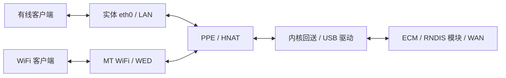

<div align="center">

# OpenFi 6C · ImmortalWrt 25.12

**闭源 MT WiFi · USB HNAT · 四点风扇曲线 · USB 5G 上网**


[下载固件](https://github.com/tcpqueue/immortalwrt-openfi6c-25.12/releases/latest) · [编译说明](#编译固件) · [适配细节](docs/openfi6c-25.12.md) · [USB HNAT 实现](docs/openfi6c-usb-hnat.md)

</div>

面向 **OpenFi 6C** 的完整源码仓库，基于 `chasey-dev/immortalwrt-mt798x-rebase` 的 `25.12` 分支，迁移官方板级适配，使用 MediaTek 闭源 WiFi 驱动，并完善 USB 上网和设备管理。

**当前版本：2026-10-15，尚未经实机验证。** 上一个实机验证版本为 [2026-09-12](https://github.com/tcpqueue/immortalwrt-openfi6c-25.12/releases/tag/v25.12-openfi6c-20260912)（设备使用正常，USB HNAT 可用）。当前支持模块通过 **ECM / RNDIS** 模式上网。

2026-10-15 版恢复 Aurora 主题，OpenFi 管理页面改用 LuCI JavaScript 实现，在线软件源改用北京大学镜像并移除不存在的 video 源；内核与驱动同 2026-10-14 版。2026-10-14 版同步上游至 `468e251`（2026-10-12，Linux 6.12.112），并更新 PassWall2、Xray、Tailscale LuCI 和 Go 1.27.2。USB HNAT 回送修正已按上游新的收包代码重写，160 组分派用例通过；详见 [USB HNAT 实现说明](docs/openfi6c-usb-hnat.md#2026-10-13-上游同步)。

OpenFi 管理插件 `2026.10.15-r1` 改用 LuCI JavaScript 视图，页面样式跟随所选主题，不再依赖 luci-compat；详见 [风扇切换修复说明](docs/openfi6c-fan-switch.md#20261015-r1)。2026-10-14 版所含的 `2026.10.13-r1` 修复输出下限覆盖曲线、应用设置时重新全速启动、起转助推后缓降过慢、停止服务时全速保护可能失效及指示灯恢复后不跟随网口等问题，并移除无需登录的工厂测试页；详见 [风扇切换修复说明](docs/openfi6c-fan-switch.md)。

## 硬件与模块

| 项目 | 说明 |
| --- | --- |
| 设备 | OpenFi 6C，采用第二版硬件定义，兼容第一版关键引脚和分区布局 |
| 处理器 | MediaTek MT7981B |
| 内存 / Flash | 官方规格为 1GB DDR4 / 256MB NAND |
| 接口 | 单个千兆实体网口、USB 3.0、M.2 5G 模块接口、TF 卡槽 |
| 模块模式 | **ECM、RNDIS**，由模块完成拨号，路由器通过 DHCP 获取网络 |
| 推荐模块 | **移远 Quectel 高通 X55、X62 系列**，推荐带独立 Web 管理页面的模块及固件 |

模块的 APN、拨号和工作模式建议在模块自带的 Web 页面中设置。选购时请确认具体型号、固件及接口支持 ECM/RNDIS 和对应的 Web 管理功能；仅凭芯片平台不能判断这些功能是否具备。

## 固件特性

### 无线与网络

- **闭源 MT WiFi 7.6.7.3**，配套 `mt7981-fw-20260601` 和 LuCI 无线管理。
- **实体网口作为 LAN**，USB 模块作为 DHCP WAN，WAN6 跟随 WAN。
- USB WAN 根据真实设备路径和驱动识别，兼容模块接口名为 `usbX`、`ethX` 的情况。
- **USB HNAT 硬件加速已实机验证**，支持单 MAC 拓扑下的内部回送，保留 WED 相关组件。
- 手动调整 WAN 协议或设备后，自动识别逻辑保留用户设置。

### 风扇与设备管理

- 以 **CPU 温度**为基准，提供 **四个控制点**的风扇曲线，可直接拖动图表或输入整数调整。
- 最低输出 **5%**，带启动助推、过热全速和 PWM 初始化重试。
- 实体开关可用于 **5G 模块电源**或**指示灯**控制。
- 沿用官方 Factory、引导和 UBI 分区布局，适配 Linux 6.12 的设备树与 PWM 管理。

### 软件管理

- 新增插件源码直接放在 **`package/`**，便于修改和维护。
- PassWall2 和依赖来自各自上游源码，使用 **Xray + HAProxy**。
- 标准 feeds 用于公共依赖和构建支持，固定到本次构建使用的提交。
- 内置中文语言包，提供 **Aurora / Bootstrap** 主题。

## 内置软件

| 类别 | 软件与功能 |
| --- | --- |
| 代理 | PassWall2 **26.10.1-r2**、Xray **26.10.10**、HAProxy **3.2.21**（SSL/Lua） |
| 组网 | Tailscale 社区版 LuCI，核心 **1.98.3** |
| 文件服务 | OpenList LuCI **4.2.4** / 核心 **4.2.6**，Samba4 **4.22.7** |
| 磁盘管理 | DiskMan **0.2.13**，分区、文件系统及 SMART 工具 |
| 网络管理 | MTK EQoS、TurboACC、TimeWOL + etherwake、UPnP（nftables） |
| 统计监控 | LuCI Statistics、collectd，CPU、内存、负载、接口、无线、Ping、温度等 |
| 基础管理 | 防火墙、APK 软件包管理、IPv6、PPPoE、HTTPS LuCI、uHTTPd 设置 |
| 维护工具 | 网页终端、htop、nano、curl、tcpdump、tcping、ethtool、lscpu、lsof、温度工具、CoreMark、SFTP |
| 外观 | Aurora **1.4.0**、Bootstrap、中文翻译 |

代理核心仅选择 Xray；`v2ray-geoip` / `v2ray-geosite` 是规则数据。当前固件未包含独立 V2Ray、Shadowsocks、Sing-box 核心，也未编入 `qcserial` 或 PCIe 蜂窝模块驱动。

## 网络与 USB HNAT



这是功能示意图。USB 总线收发和 ECM/RNDIS 协议处理仍需要 CPU，符合条件的转发/NAT 进入 PPE；代理和加密运算不属于这项硬件 NAT 功能。

当前设备树只启用实体口对应的 **硬件 MAC1**，Linux 将它命名为 **`eth0`**。驱动已修正内部回送对硬件 MAC0 的固定依赖，无需创建额外空网口。具体路径、端口解析及测试依据见 [USB HNAT 实现说明](docs/openfi6c-usb-hnat.md)。

## 下载与升级

1. 打开 [Releases](https://github.com/tcpqueue/immortalwrt-openfi6c-25.12/releases)，下载 `sysupgrade.bin`。
2. 根据同一 Release 的 `sha256sums` 核对校验和，备份当前配置。
3. 在 LuCI 的固件升级页面选择升级包。

从旧 24.10 / 6.6 固件迁移时，建议不保留旧配置：新版实体网口名称和无线配置后端有变化。

本次升级包约 **89.84 MiB**；官方 256MB NAND 布局的 UBI 分区为 **233.5 MiB**。具体硬件和分区应以实机为准。

<details>
<summary>固件校验和</summary>

```text
ba613a7f8dfa878eab9fb3e49384dc51a136efead25317ae20c1c090a80654aa  OpenFi6C-25.12-20261015-sysupgrade.bin
e02a228bf4dd8ea2bf08670aef57f1f8d51d21ea2b02da1259b94ab68640e597  OpenFi6C-25.12-20260912-USBHNAT-sysupgrade.bin
```

前者为 2026-10-15 版（[软件清单](releases/2026-10-15/packages.manifest)），后者为 2026-09-12 实机验证版（[软件清单](releases/2026-09-12/packages.manifest)）。

</details>

## 编译固件

建议使用 **Ubuntu 24.04 / WSL2**，16GB 内存并预留足够的 Linux 磁盘空间。WSL 下将项目放在 `~/projects/` 等 Linux 原生目录，`/mnt/...` 仅用于与 Windows 传输文件。

安装基础依赖：

```sh
sudo apt update
sudo apt install -y build-essential clang flex bison g++ gawk gcc-multilib \
  g++-multilib gettext git libncurses-dev libssl-dev libelf-dev zlib1g-dev \
  python3 python3-dev python3-setuptools python3-pyelftools python3-ply \
  rsync unzip file wget curl ca-certificates subversion swig cmake ninja-build \
  autoconf automake libtool pkgconf ccache help2man patch time xsltproc \
  zstd liblz4-tool libzstd-dev device-tree-compiler lua5.1
```

准备源码和项目 Python 环境（需已安装 [uv](https://docs.astral.sh/uv/getting-started/installation/)）：

```sh
mkdir -p ~/projects
cd ~/projects
git clone -b 25.12 https://github.com/tcpqueue/immortalwrt-openfi6c-25.12.git
cd immortalwrt-openfi6c-25.12
uv venv --python 3.12.14 .venv
source scripts/openfi-env.sh
```

安装固定版本的公共依赖并加载 OpenFi 配置：

```sh
./scripts/feeds update -a
./scripts/feeds install -a
cp defconfig/mt7981-ax3000-openfi6c.config .config
make defconfig
uv run --no-project scripts/check-openfi-packages.py
```

源码中已有的插件会优先使用。不要用 `feeds install -f` 覆盖它们，也不需要另加 PassWall2、OpenList 或 Tailscale feed。

先多线程下载，再编译：

```sh
make download -j"$(nproc)"
make -j"$(nproc)"
```

产物位于 `bin/targets/mediatek/filogic/`，升级文件名为 `immortalwrt-mediatek-filogic-openfi_6c-squashfs-sysupgrade.bin`。

修改适配后可运行检查：

```sh
make target/linux/prepare
bash scripts/check-openfi6c.sh
```

检查覆盖设备树、风扇控制、表单整数校验、USB WAN 自动识别和 **160 组 HNAT 收包分派用例**。Go 1.27.2 编译配方已直接放入源码，供 Xray / OpenList 使用。

## 源码布局

| 路径 | 内容 |
| --- | --- |
| `defconfig/mt7981-ax3000-openfi6c.config` | 完整设备与插件配置 |
| `target/linux/mediatek/dts/mt7981b-openfi-6c.dts` | OpenFi 6C 设备树 |
| `target/linux/mediatek/patches-6.12/999-zzz-5119-*` | 单 MAC 与 WDMA 内部回送修正 |
| `package/mtk/applications/luci-app-openfi/` | 风扇、实体开关及设备管理 |
| `package/passwall2/`、`package/passwall-packages/` | PassWall2 与依赖源码 |
| `package/tailscale-community/`、`package/openlist/` | Tailscale 社区版、OpenList |
| `package/user-apps/`、`package/luci-theme-aurora/` | 其他应用及主题源码 |
| `tests/openfi6c/` | 适配回归检查 |

## 上游与许可

- 固件基础：[chasey-dev/immortalwrt-mt798x-rebase](https://github.com/chasey-dev/immortalwrt-mt798x-rebase)，`25.12`。
- 官方硬件参考：[OpenWrt01/immortalwrt-mt798x-24.10](https://github.com/OpenWrt01/immortalwrt-mt798x-24.10/tree/openwrt-24.10-6.6)。
- 各应用来源、固定提交与本地适配记录：[软件来源](docs/openfi6c-app-sources.txt)、各目录的 `SOURCE.md`。

本仓库保留上游版权与许可证声明。ImmortalWrt、Linux、LuCI、应用软件和厂商驱动分别遵循各自许可证，详见 [LICENSES](LICENSES/) 和对应源码目录。
